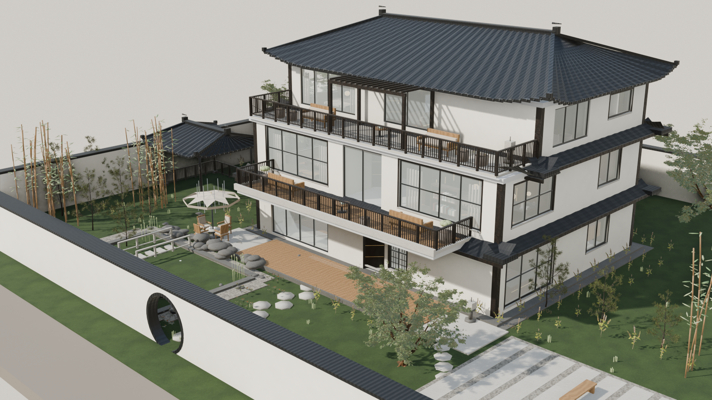
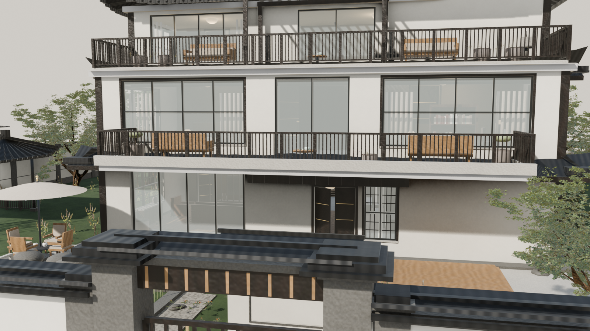
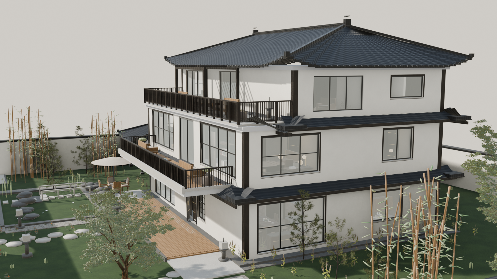
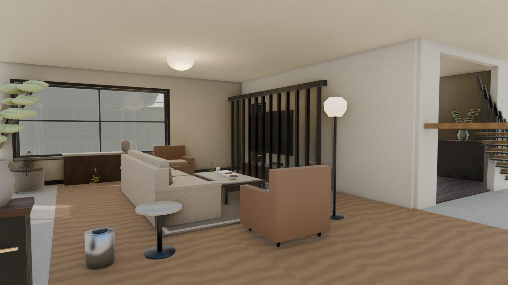
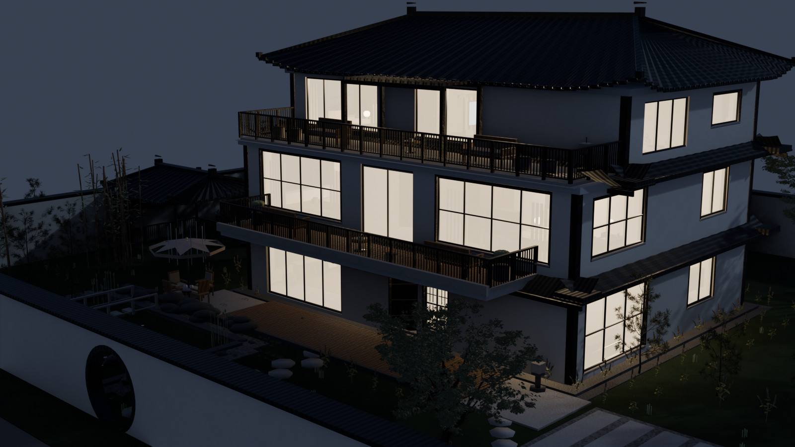
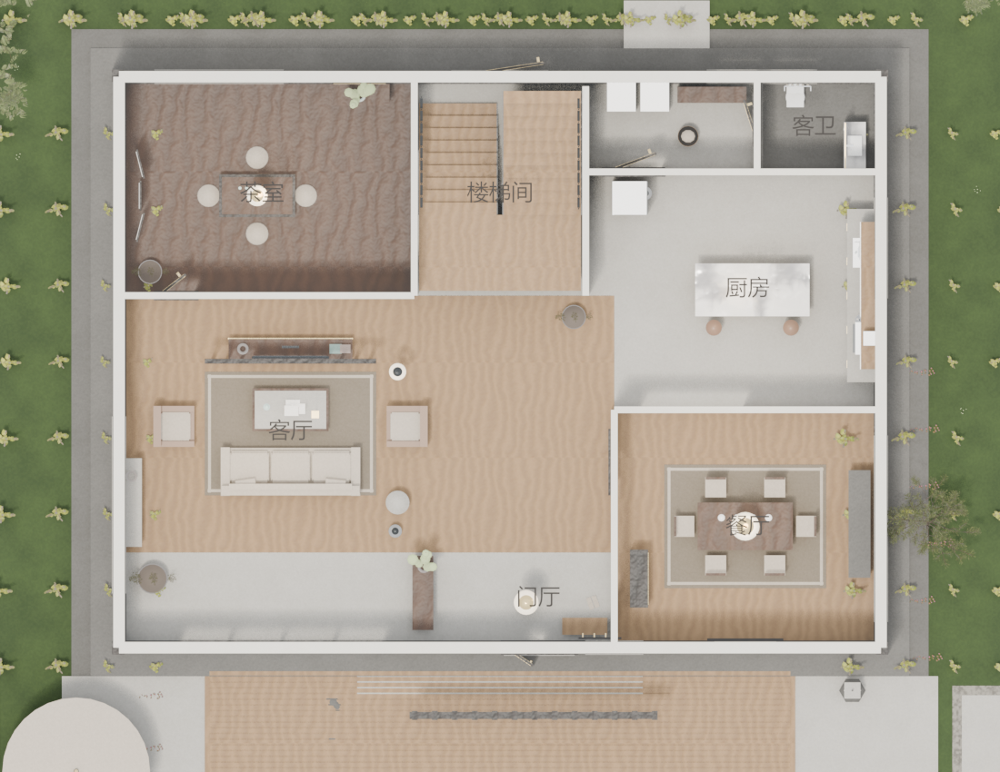
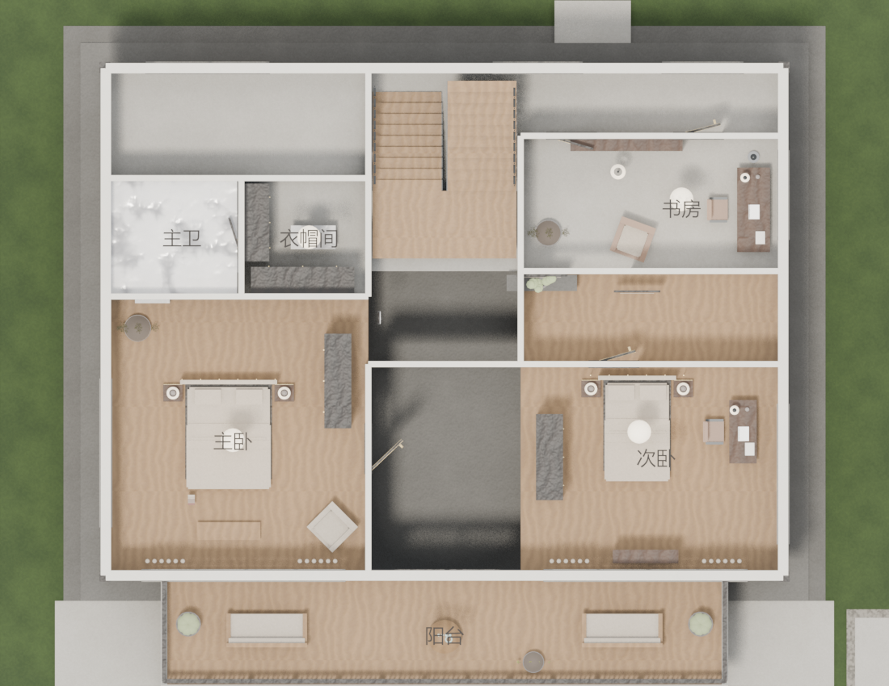
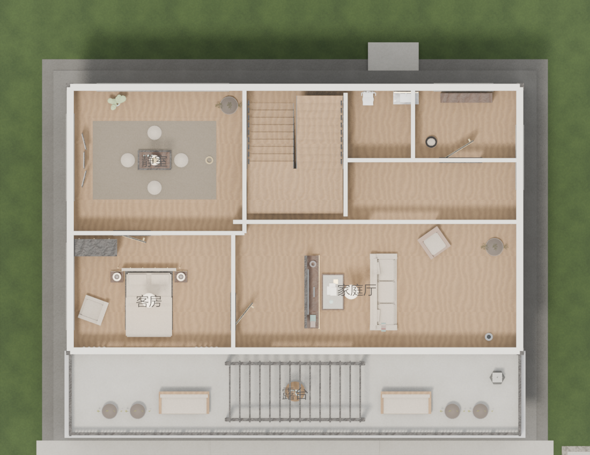
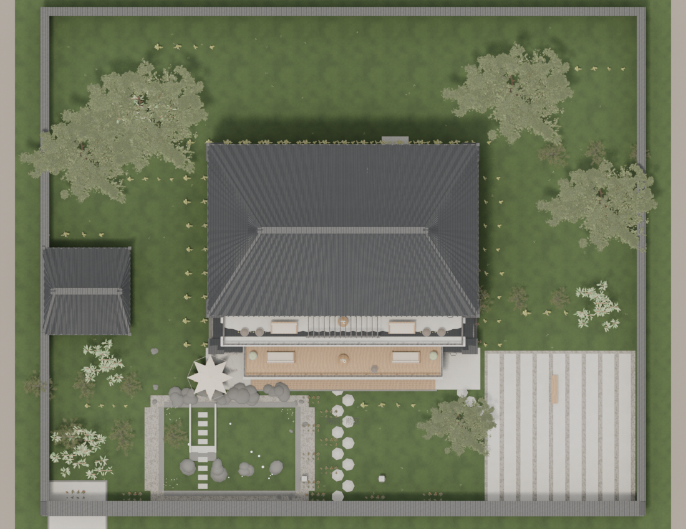
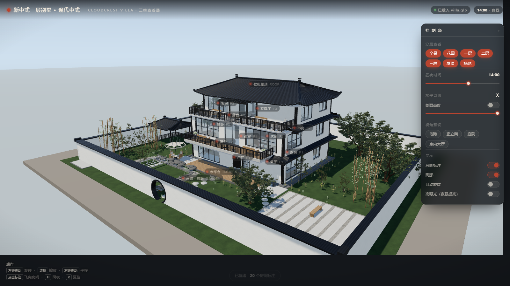

# 云嵴山居 · Cloudcrest Villa

[](https://hanbuss.github.io/cloudcrest-villa/villa/viewer/index.html)
[](https://www.blender.org/)
[](https://threejs.org/)
[](LICENSE)

> 🏠 **直接看效果**：<https://hanbuss.github.io/cloudcrest-villa/villa/viewer/index.html>
> （首次打开需加载 57 MB 模型，稍等几秒）

一栋**三层现代新中式别墅**的完整程序化工程：Blender Python 脚本从零生成建筑、家具、植被与材质，导出网页模型，并附一个可分层、可昼夜、可点房间的离线 Three.js 查看器。

> 整栋楼由 `build_villa.py` 一次性重建（约 3 秒），没有任何手工建模步骤。



---

## 目录

- [它长什么样](#它长什么样)
- [快速开始](#快速开始)
- [在线查看器](#在线查看器)
- [工程结构](#工程结构)
- [设计与技术要点](#设计与技术要点)
- [布局审查](#布局审查)
- [复刻](#复刻)
- [许可](#许可)

---

## 它长什么样

| 庭院正视 | 东侧全景 |
|---|---|
|  |  |

| 客厅内景 | 夜景 |
|---|---|
|  |  |

| 一层平面 | 二层平面 |
|---|---|
|  |  |

| 三层平面 | 总平面 |
|---|---|
|  |  |

---

## 快速开始

需要 **Blender 5.1+** 与 **Python 3.10+**（只用到 numpy）。

```bash
git clone https://github.com/hanbuss/cloudcrest-villa.git
cd cloudcrest-villa/villa

# 1) 生成贴图（12 套可平铺 PBR，约 1 秒）
python lib/texgen.py --res 512

# 2) 生成成品植被（可选，会从 PolyHaven 下载 CC0 模型）
#    assets/*.blend 未入库；跳过这一步则建筑与程序化植物照常生成
blender -b --python prep_assets.py -- pine jacaranda shrub flower cover

# 3) 建整栋楼 → villa.blend / villa.glb / rooms.json
blender -b --python build_villa.py

# 4) 布局体检（浮空 / 沉地 / 穿墙 / 越界 / 穿插）
blender -b villa.blend --python audit.py

# 5) 出图
blender -b villa.blend --python render_shots.py -- cams=CAM_Hero,CAM_Court res=1600x900 mode=day
blender -b villa.blend --python render_shots.py -- cams=CAM_Night res=1600x900 mode=night
blender -b villa.blend --python plan_shots.py
```

> Windows 下把 `blender` 换成完整路径，例如
> `blender -b --python build_villa.py`。

---

## 在线查看器

```bash
cd villa
python -m http.server 8901
# 打开 http://127.0.0.1:8901/viewer/index.html
```

> ES module 在 `file://` 下会被浏览器拦，必须走 http。**服务根目录是 `villa/`**，不是 `viewer/`。

| 能力 | 说明 |
|---|---|
| 旋转 / 缩放 / 平移 | OrbitControls，禁钻地、阻尼、按需渲染 |
| 分层查看 | 全景 / 花园 / 一层 / 二层 / 三层 / 屋顶 / 场地 |
| 昼夜光照 | 0–24 h 滑杆：太阳方位 + 渐变天空 + 环境光照 |
| 房间标注 | 20 个房间自投影标签，按楼层过滤、防重叠 |
| 点房间 | 自动隐藏其他层 + 掀顶剖切 + 飞入该房间（剖面视角） |
| 水平剖切 | 0–10 m 滑杆，随时切开看内部 |
| 视角预设 | 鸟瞰 / 正立面 / 庭院 / 室内，`R` 键复位 |
| 完全离线 | Three.js 与加载器全部本地 vendor，不依赖 CDN |



---

## 工程结构

```
.
├── PROMPT.md                  # ★ 复刻提示词（喂给 AI Agent 即可重做一遍）
├── villa/
│   ├── build_villa.py         # 总装脚本
│   ├── lib/
│   │   ├── kit.py             # 累积式几何内核 GB + 三向 box UV
│   │   ├── mats.py            # 57 种材质 + 贴图接线
│   │   ├── arch.py            # 开洞墙 / 门窗 / 栏杆 / 楼梯 / 庑殿顶 / 披檐 / 月洞门 / 亭
│   │   ├── furni.py           # 50+ 家具与生活小物
│   │   ├── nature.py          # 程序化植物
│   │   ├── details.py         # 11 樘门扇 + 檐角戗檐
│   │   ├── gate.py            # 院墙 / 门楼 / 影壁 / 车行门（新中式三段式）
│   │   ├── texgen.py          # 程序化贴图（纯 numpy 自写 PNG 编码器）
│   │   └── assets.py          # 成品模型实例化（共享 mesh）
│   ├── prep_assets.py         # PolyHaven 模型预处理
│   ├── audit.py               # 布局审查
│   ├── render_shots.py        # 日 / 夜出图
│   ├── plan_shots.py          # 逐层正交平面图（中文标注）
│   ├── textures/              # 12 套 albedo + normal
│   ├── previews/              # 出图
│   ├── viewer/index.html      # 单文件查看器
│   ├── villa.glb              # 网页模型（228 mesh / 57 材质）
│   ├── rooms.json             # 20 房间锚点（glTF Y-up 坐标）
│   ├── walls.json             # 真实墙段（审查用）
│   └── 设计说明.md             # 完整设计文档
└── .github/workflows/pages.yml
```

---

## 设计与技术要点

### 一次跑完，不用手工

`GB` 类把每个空间/构件累积成**一个多材质 mesh**——全楼上千件东西只产出 228 个对象。这是浏览器能流畅旋转它的前提。

### 材质：12 套程序化贴图

`lib/texgen.py` 用 numpy 自己写 PNG 编码器（zlib + crc32），生成**严格可平铺**的石膏、石材、大理石、三种木纹、筒瓦、亚麻、地毯、草坪、砾石。UV 用**三向 box 投影**（世界坐标 ÷ 2 m），任意物体密度一致、不拉伸，导出为 glTF 的 `KHR_texture_transform`。

### 植被：程序化 + 成品模型混合

- 程序化：竹林、造型松、睡莲、景石、草丛
- 成品（PolyHaven CC0）：`jacaranda_tree`（19.3 万面）、`pine_sapling_small`、`shrub_03`、花境与地被

成品模型一次性预处理成 `assets/*.blend`（导入 → 合并 → 减面 → 贴图压 512 → 落地归一化），构建时 append 一次、其余副本**共享同一份 mesh**，glTF 只写一份几何。

### 院墙 / 门楼 / 影壁 / 水池：档次来自分段与收口

这一轮把"素白墙 + 黑压顶 + 月洞门"整体换掉，判据只有一个：**长墙必须被切开，构筑物必须有压顶与檐口**。

| 件 | 关键规格 |
|---|---|
| 院墙 | 勒脚 450 + 墙身 + 1000 mm 腰线 35 + 压顶（出挑 50）+ 筒瓦双坡 17°（出挑 200），壁柱每 4.2 m 一道 460 见方 |
| 门楼 | 600 方石柱 ×2（高 3.10、柱帽 + 四坡瓦檐）+ 深木横梁 9 格 + 梁上瓦檐出挑 0.74 + 石匾 + 抱鼓石 + 三级踏步 |
| 入户门 | 双开 1.24×2.26 每扇，下段实心板 1.36 + 中横档 + 上段竖格栅 0.79 + 门套 / 内衬 / 门槛石四件齐 |
| 影壁 | 两级台基 + 白墙（正反石框 + 圆形砖雕 φ1.24）+ 八字翼墙 1.42 + 起翘瓦顶 |
| 车行门 | 开口 5.2 m，石柱 + 深灰金属竖条推拉门（半开） |
| 水池 | 草地按池沿拆 4 块开洞、池壁 140 石砌、压顶 0.10 高出草地 80、水面 −0.14、睡莲 16 + 景石 3 组 |
| 遮阳伞 | 伞面 32 段 × 4 环旋转体（不是 8 片三角），伞骨收在伞面内，圆桌环形开孔让伞杆穿过 |

全套共 4 个新 mesh：`SITE_PerimeterWall` / `SITE_MainGate` / `SITE_CarGate` / `SITE_ScreenWall`，查看器可单独隐藏。

### 查看器：一套坐标约定撑起所有功能

Blender `(x, y, z)` → glTF `(x, z, −y)`，因此**花园在 +Z**。分层靠导出时的顶层空物体（`SITE/GARDEN/F1/F2/F3/ROOF`）；房间标签靠 `rooms.json`；点房间 = 只留该层 + 按房间高度自动剖切 + 斜上方机位，避免相机钻进墙体。

**手机适配**（断点 860 px 或 `pointer: coarse`）：控制台变成底部抽屉（默认收起，只露 50 px 把手）、鼠标提示换成触屏提示、房间标注默认关闭（开启后限 5 个且只显示在安全区内）、`pixelRatio` 上限 1.6、Canvas `touch-action: none`。深链 `?panel=open` 可直接展开面板。

---

## 布局审查

`audit.py` 把"看起来别扭"变成可量化的清单，用构建时导出的**真实墙段**逐段比对：

| 类别 | 判据 |
|---|---|
| 浮空 | 离地 > 6 cm |
| 沉地 | 低于楼板 > 6 cm |
| 穿墙 | 与墙段重叠 > 5 cm |
| 越界 | 超出建筑外轮廓 |
| 互相穿插 | 两件家具包围盒重叠 > 5 cm |

当前结果：**五类全 0**（170 家具 + 56 构件）。

> 第一版审查用整层墙 mesh 的包围盒判穿墙，结果墙覆盖全楼、所有家具都报错——教训写进 `PROMPT.md` §4 第 6 条。

---

## 部署

推到 GitHub 与开启 Pages 的三种方式（含无法直连 GitHub 时的离线搬运方案）见 **[DEPLOY.md](DEPLOY.md)**。

---

## 复刻

想把这一整套重新做一遍（或换一栋楼），把 [`PROMPT.md`](PROMPT.md) 整段喂给具备文件读写与 Blender 能力的 AI Agent。

里面写死了：尺寸参数、20 个房间清单、十二条工程约束、四阶段工作流（骨架 → 布置 → 审查 → 精修）、材质与植被管线、查看器规格、逐图反馈的迭代协议、验收清单，以及一张踩坑速查表。

---

## 许可

- **本项目代码与文档**：MIT
- **成品植被模型**：[PolyHaven](https://polyhaven.com/) CC0（可商用、无需署名）
- **Three.js**：MIT

别墅设计（云嵴山居）为原创方案，可自由参考。
