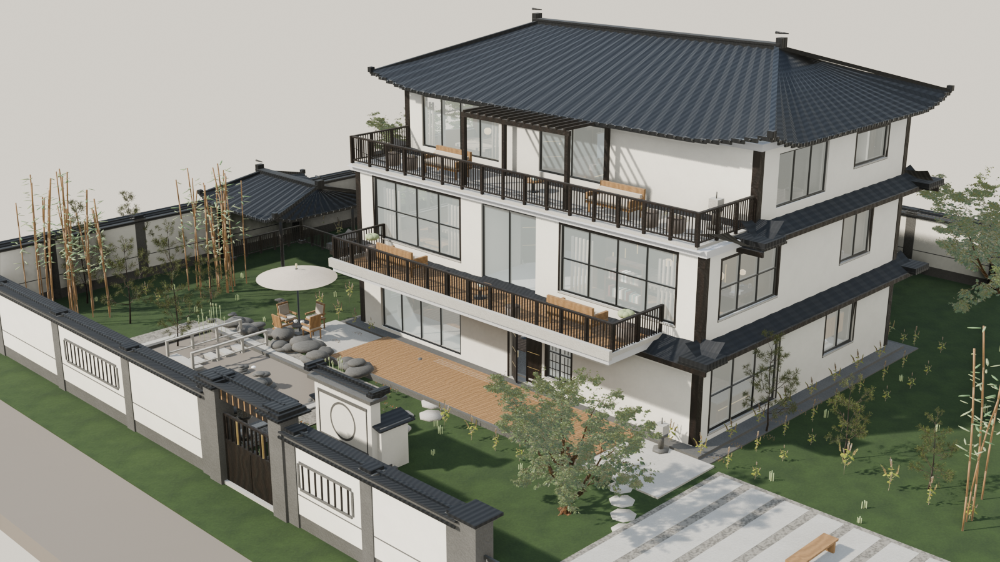
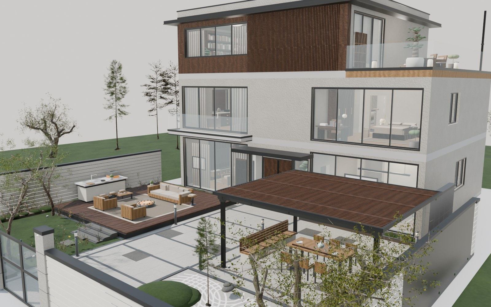
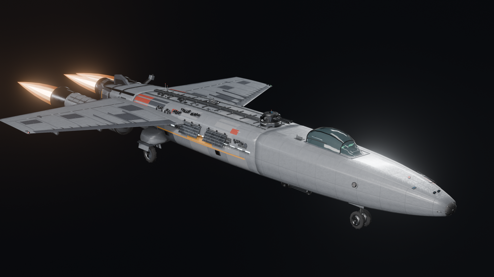

# AI 建模提示词 · AI 3D Modeling Prompts

用**提示词驱动 AI Agent**，从几张参考照片开始，把一栋建筑做成 Blender 程序化工程 + 可交互网页模型。

这个仓库不是模型下载站，是**两套被跑通过的提示词 + 两份跑出来的完整工程**。
提示词里每一条硬约束都是实际踩坑之后写进去的——照做能省掉一大半弯路。

---

## 两个项目

| # | 项目 | 风格 | 提示词 | 工程与成品 |
|---|---|---|---|---|
| 01 | **云嵴山居** | 三层新中式别墅 · 中式庭院 · 210 m² 南院 | [prompts/new-chinese-villa.md](prompts/new-chinese-villa.md) | [projects/01-new-chinese-villa/](projects/01-new-chinese-villa/) |
| 02 | **现代简约别墅** | 三层现代简约 · 225 m² 前院 · 街景邻栋 | [prompts/modern-minimal-villa.md](prompts/modern-minimal-villa.md) | [projects/02-modern-minimal-villa/](projects/02-modern-minimal-villa/) |
| 03 | **AEGIS-7 «Kestrel»** | 科幻重型截击舰 · 220 可拆零件 · 引擎尾焰 + 激光 | [prompts/aegis-7-starship.md](prompts/aegis-7-starship.md) | [projects/03-aegis-7-starship/](projects/03-aegis-7-starship/) |

**在线看（GitHub Pages）**

- 01 新中式：<https://hanbuss.github.io/AI-3D-modeling-prompts/projects/01-new-chinese-villa/viewer/index.html>
- 02 现代简约：<https://hanbuss.github.io/AI-3D-modeling-prompts/projects/02-modern-minimal-villa/viewer/index.html>
- 03 Kestrel 飞船：<https://hanbuss.github.io/AI-3D-modeling-prompts/projects/03-aegis-7-starship/viewer/index.html>

> 首次打开要下载 50–57 MB 的模型，等几秒。手机上也做了适配（窄屏右侧面板收成底部抽屉）。

| 01 云嵴山居 | 02 现代简约 |
|---|---|
|  |  |

| 03 AEGIS-7 «Kestrel» |
|---|
|  |

---

## 怎么用这些提示词

1. 打开 `prompts/` 下任意一份，**整段**喂给具备「文件读写 + 命令行 + Blender」能力的 AI Agent。
2. 同时给它 **4–6 张同风格的参考照片**（自己的图或合法来源的图）。
3. 只补一句比例基准（门洞 2.10 / 栏杆 1.05 这类），不要再写文字复述图片。
4. 按提示词里的**阶段门**一段一段推进，每段停下出图验收，别指望一条提示词做完整个项目。

两份提示词可以互换风格复用——换风格只改「立面语言」那一节，其余骨架通用。

---

## 目录

```
.
├── prompts/                        提示词（核心资产）
│   ├── new-chinese-villa.md        01 的复刻提示词
│   ├── modern-minimal-villa.md     02 的复刻提示词
│   └── aegis-7-starship.md         03 的复刻提示词（程序化飞船 + 剖析页）
├── projects/
│   ├── 01-new-chinese-villa/       云嵴山居：脚本 + GLB + 查看器 + 效果图
│   ├── 02-modern-minimal-villa/    现代简约：脚本 + GLB + 查看器 + 效果图
│   └── 03-aegis-7-starship/        飞船：脚本 + GLB + 剖析页 + 效果图
├── index.html                      落地页（Pages 根）
└── LICENSE                         MIT
```

每个 `projects/xx/` 都是**可一键重建**的工程，不是手工 .blend：

```bash
blender -b --factory-startup --python build*.py -- --save   # 重建 + 导出 GLB
blender -b *.blend --python audit.py                        # 布局审查，必须 PASS
blender -b *.blend --python render_shots.py -- cams=... mode=day
python -m http.server 8000                                  # → /viewer/index.html
```

---

## 两套工程的技术共同点

| 共同做法 | 为什么 |
|---|---|
| 用 `GB` 累积式几何构建器 | 一个 mesh 承载几百个图元，避免上千物体拖垮 GLB 导出与网页帧率 |
| `LAYOUT.md` 作为坐标唯一真源 | 多模块并行时，尺寸只在一个地方定义，改设计先改它 |
| `audit.py` 硬门 | 越界 / 穿墙 / 丢材质 / 退化面，不 PASS 不出图 |
| 分层命名（`ARCH_1F` / `INT_2F` / `ROOF`…） | 层名会成为 GLB 节点名，查看器直接按名字做楼层显隐 |
| 只信图不信 bbox | bbox 全绿但铺装花成棋盘、树堆在原点——只有渲染出来才看得见 |
| 第三方素材统一预处理 | 应用对象变换 → 归一化到底部原点 → 贴图降到 1k 并打包 → 减面 |

## 两套工程最容易踩的坑

1. **`GB.frame()` 是上下文管理器**，不写 `with` 变换不进栈——曾让 4.8 万面的树全部堆在原点，相机被一棵"巨树"挡死。
2. **别拉高小树**：5 m 的树拉到 8.5 m 会变细长扫帚；地被草本（0.2–0.4 m）当灌木拉到 0.9 m 会变细棍。
3. **共面必然闪**：挑檐顶与屋面板底、格栅与墙面、框料与玻璃，任何两面贴合都会在 GLB 深度精度下闪烁，要拉开 ≥20 mm。
4. **墙内皮与房间盒差一个墙厚**时，贴墙家具会埋进墙里，必须成组内收。
5. **大地面板 z 要低于院内底板**，否则整块场地被草坪盖住。

---

## 素材与许可

代码与模型 **MIT**。第三方素材：**PolyHaven（CC0）** 植被与户外家具、**three.js（MIT）**、**Blender（GPL，仅作工具）**。
逐项署名见各项目下的 `CREDITS.md`。

**参考照片未随仓库分发** —— 两套工程的参考图均为第三方网图，仅用于设计参考，不在本仓库内。

---

<sub>由 AI Agent 与提示词协作产出 · Blender Python · three.js</sub>
