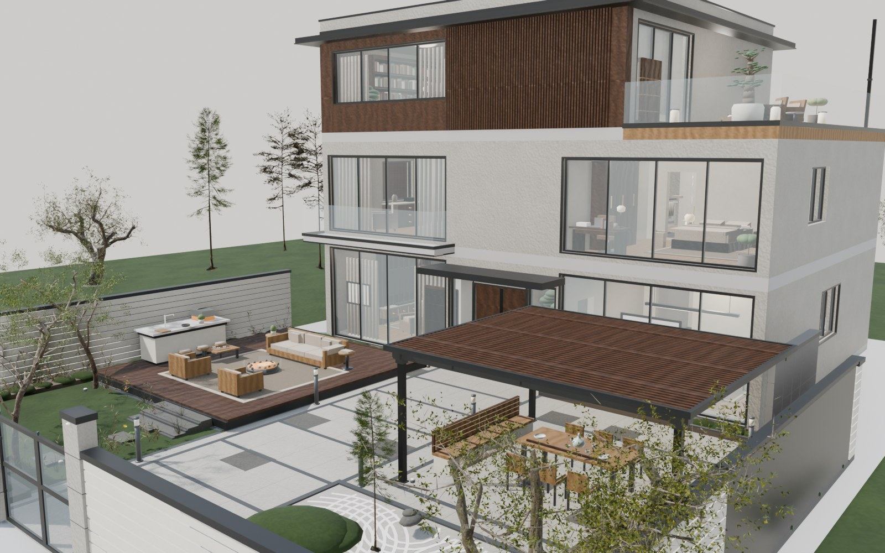
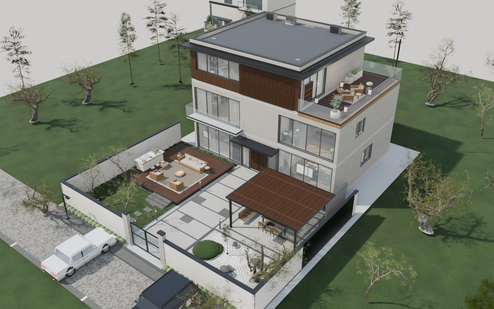
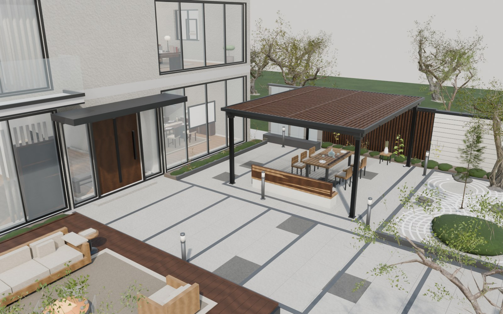
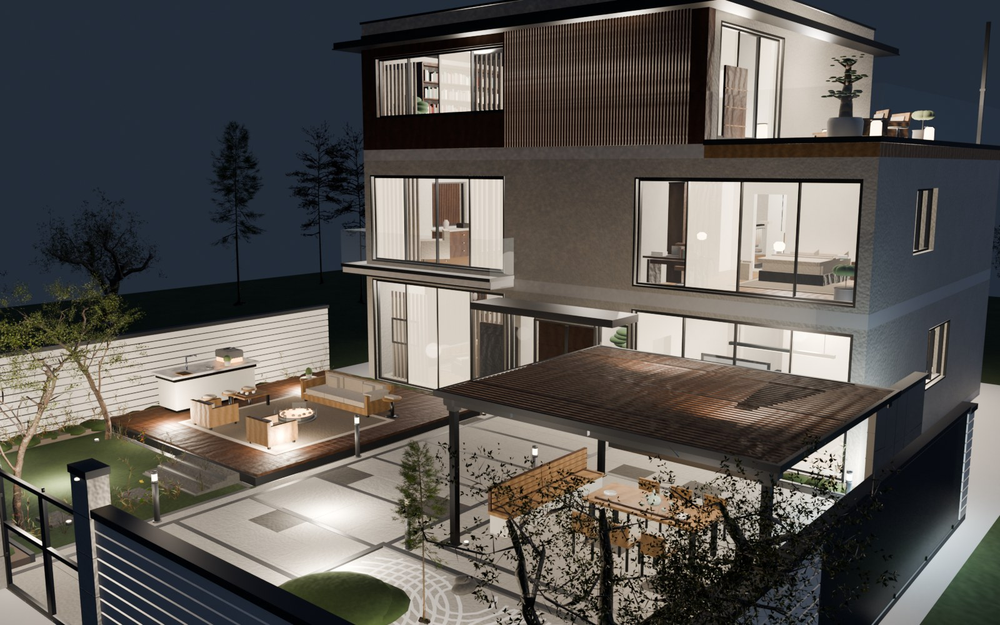
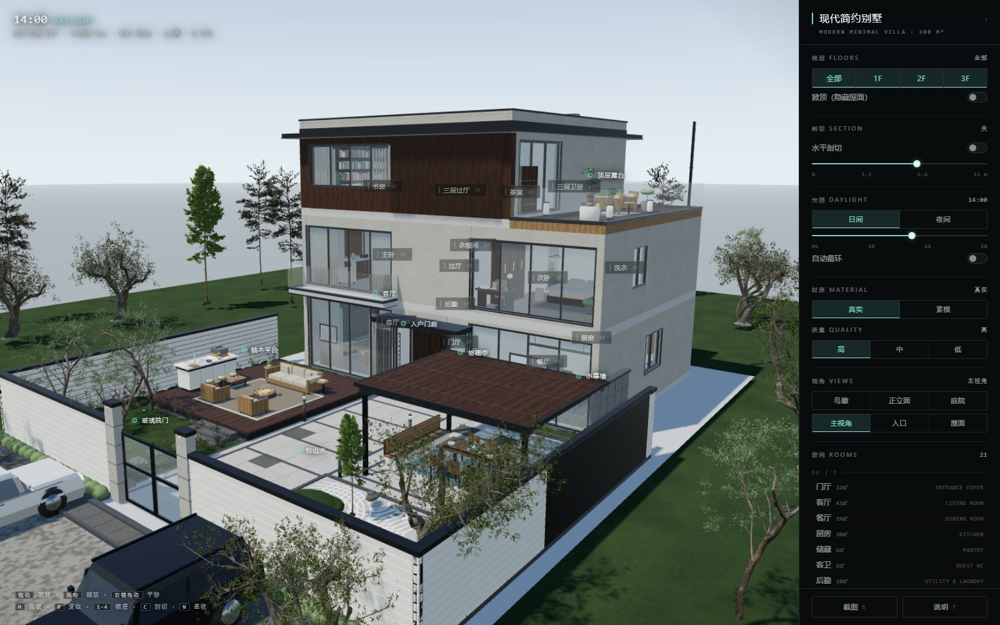

# 现代简约别墅 · Modern Minimal Villa

一栋**全程序化生成**的三层现代简约别墅与庭院，由参考照片复刻。Blender Python 建模，
导出 glTF，配一个**离线可用、手机适配**的 three.js 交互查看器。



| 鸟瞰 | 庭院 |
|---|---|
|  |  |

| 夜景 | 查看器 |
|---|---|
|  |  |

---

## 一、直接看

### 网页里转着看（推荐）

仓库根目录起一个静态服务，然后打开 `viewer/index.html`：

```bash
python -m http.server 8000
# → http://127.0.0.1:8000/viewer/index.html
```

> 必须走 http，`file://` 会让 GLB 的 fetch 失败。
> 手机：同一局域网把 `127.0.0.1` 换成电脑内网 IP 即可。窄屏会自动把右侧面板收成底部抽屉，
> 手势是「单指旋转 / 双指缩放 / 双指平移」。

### 在 Blender 里改

打开 `mvilla.blend`（Blender 5.1+）。全部几何都是脚本生成的，改脚本比改网格更划算。

### 只想拿模型

`mvilla.glb`，任何支持 glTF 2.0 的引擎都能直接读。

---

## 二、它是什么

- **场地** 18 × 24 m；**建筑** 14.4 × 10.5 m；**前院** 225 m²
- **三层**，层高 3.15 / 3.00 / 3.00 m，平屋面 + 0.55 m 薄挑檐，屋面放空调外机、落水管、检修口
- **21 间房**：一层门厅 / 客厅 / 餐厅 / 厨房 / 储藏 / 客卫 / 后勤，二层主卧套房 + 次卧套房 + 洗衣 + 书房角，
  三层书房 / 客卧 / 茶室 / 露台
- **立面语言**：浅色石灰石大板（真板缝）+ 暖柚木竖格栅 + 近黑金属收边 + 通高玻璃
- **庭院十一要素**：800 板砂岩铺装（缝是几何不是贴图）+ 黑花岗岩分区线、柚木 Deck、
  户外厨房岛台、格栅亭、水幕墙、枯山水（40 多圈真耙纹）、草坪汀步、玻璃院门、白横格栅围墙、20 盏园林灯
- **40 mesh / 1,346,320 面 / 44 盏灯 / 91 种材质**
- 场景含院外街道与**三种户型的邻栋**，鸟瞰才站得住

---

## 三、目录

```
.
├── build.py            总装：场地 → 建筑 → 院子 → 室内 → 灯光 → 相机 → 导出 GLB
├── audit.py            布局审查（越界 / 穿墙 / 丢材质 / 退化面），必须 PASS 才出图
├── render_shots.py     效果图渲染（day / dusk / night 三套预设）
├── plan_shots.py       分层俯视平面图
├── prep_assets.py      第三方素材预处理（烘缩放 → 归一化 → 贴图打包 → 减面）
├── LAYOUT.md           坐标与房间尺寸的**唯一真源**（改设计先改这里）
├── 设计说明.md          为什么这么设计
├── lib/
│   ├── kit.py          几何内核：GB 累积式构建器 + Ctx 图层/房间元数据/导出 + boxUV
│   ├── mats.py         基础材质 57 种（接可平铺贴图）
│   ├── mats2.py        现代材质 99 种（石材/柚木/深钢/玻璃/水/苔/汽车漆…）
│   ├── texgen.py       12 套可平铺贴图生成器
│   ├── arch2.py        建筑外壳：楼板/墙/门窗/幕墙/木格栅/屋面/阳台/楼梯/入户门
│   ├── court.py        南院：铺装/Deck/岛台/格栅亭/水幕/枯山水/围墙/院门/街景
│   ├── rooms.py        室内：21 间房软装
│   ├── furni.py        家具库 58 个构件
│   ├── nature.py       程序化植物（备用）
│   ├── cars.py         参数化轿车 / SUV（PolyHaven 无车型，自建）
│   ├── houses.py       邻栋三种户型
│   ├── lights.py       44 盏灯
│   └── assets2.py      第三方植被实例化（共享 mesh，GLB 只写一份几何）
├── textures/           12 套可平铺 PNG（albedo + normal）
├── assets/             植被与户外家具 .blend（贴图已打包）
├── viewer/             three.js 查看器（本地 vendor，不联网）
├── previews/           效果图
├── mvilla.glb          导出模型
└── mvilla.blend        Blender 工程
```

---

## 四、重新生成

```bash
# 1. 建模 + 存盘 + 导出 GLB（约 20 s）
blender -b --factory-startup --python build.py -- --save

# 2. 效果图
blender -b mvilla.blend --python render_shots.py -- \
        cams=CAM_Hero,CAM_Aerial res=1600x1000 samples=28 mode=day tag=day
blender -b mvilla.blend --python render_shots.py -- \
        cams=CAM_Hero res=1600x1000 samples=30 mode=night tag=night

# 3. 分层平面
blender -b mvilla.blend --python plan_shots.py -- res=1400x1000 samples=24

# 4. 审查（必须 PASS）
blender -b mvilla.blend --python audit.py
```

只重建某一部分（调试用）：`--only=site,arch` / `--only=site,court` / `--only=site,rooms`。

---

## 五、查看器

**鼠标**：左键拖拽旋转 · 滚轮缩放 · 右键平移
**触屏**：单指旋转 · 双指缩放 · 双指平移

| 分组 | 功能 |
|---|---|
| 楼层 | 全部 / 1F / 2F / 3F（单层 = 隐藏该层以上 + 屋面板，从上面看进去） |
| 剖切 | 掀顶 · 水平剖切滑杆（0–11 m） |
| 光照 | 日间 / 夜间 · 太阳高度 06–20 滑杆 · 自动循环 |
| 显示 | 真实 / 素模 · 质量 高 / 中 / 低 |
| 视角 | 鸟瞰 / 正立面 / 庭院 / 主视角 / 入口 / 屋面 |
| 房间 | 21 间按层分组，点一下飞到该房间（自动只留该层 + 剖切 + 斜俯视） |
| 其他 | 8 个兴趣点、截图、帮助浮层 |

URL 参数可直接进状态：`?floor=1&clip=3.3&night=1&poi=living`

---

## 六、已知限制

1. **植被是野生疏叶树种**（橄榄 / 松 / 冷杉）。按自然高度 ±30% 使用时形态正确，
   但它们不是江南庭园那种浓密树冠——想要更密要换树种，不是调参能解决的。
2. **树冠会越出院墙**（真实树木如此），`audit.py` 对庭院层单独放宽了边界。
3. **GLB 56 MB 偏重**，手机上首屏约 15 s。开 Draco 可压到 10 MB 级，查看器需补 DRACOLoader。
4. 夜景是「自发光材质 + 点光源」的简化做法，未做真实 IES 配光。
5. 室内没做天花以外的吊顶造型。

---

## 七、素材与许可

代码与模型：**MIT**（见 `LICENSE`）。

第三方素材见 [`CREDITS.md`](CREDITS.md)。要点：

- **植被与户外家具**来自 [PolyHaven](https://polyhaven.com/)，**CC0**，可自由使用。
- 查看器内置 [three.js](https://threejs.org/)，MIT。
- **参考照片未随仓库分发** —— 原始参考图为第三方网图，仅用于本项目的设计参考，不在本仓库内。

---

## 八、做法上的几条硬规则（踩过坑总结）

1. **几何内核复用**：所有图元都走 `GB` 累积式构建器，一个 mesh 承载几百个图元，
   避免上千个物体拖垮 glTF 导出与查看器。
2. **`GB.frame()` 是上下文管理器**，必须 `with`，否则变换不进栈 —— 曾让 4.8 万面的树全部堆在原点。
3. **不要拉高小树**：5 m 的树拉到 8.5 m 会变细长扫帚；地被草本（0.2–0.4 m）拉到 0.9 m 会变细棍。
4. **共面必然闪**：挑檐顶与屋面板底面、格栅与墙面、框料与玻璃，任何两面贴合都会在 GLB 深度精度下闪烁，
   必须拉开 ≥20 mm（格栅离墙用 40 mm）。
5. **坐标契约先行**：`LAYOUT.md` 是唯一真源；墙内皮与房间盒差一个墙厚时，贴墙家具会埋进墙，必须成组内收。
6. **只信图不信 bbox**：bbox 全绿但铺装花成棋盘、树堆在原点、屋面把场地盖住，只有渲染出来才看得见。
