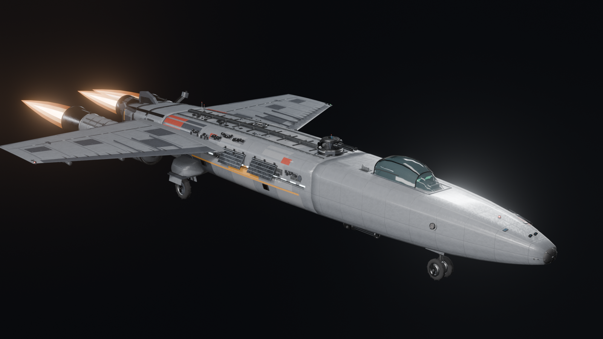
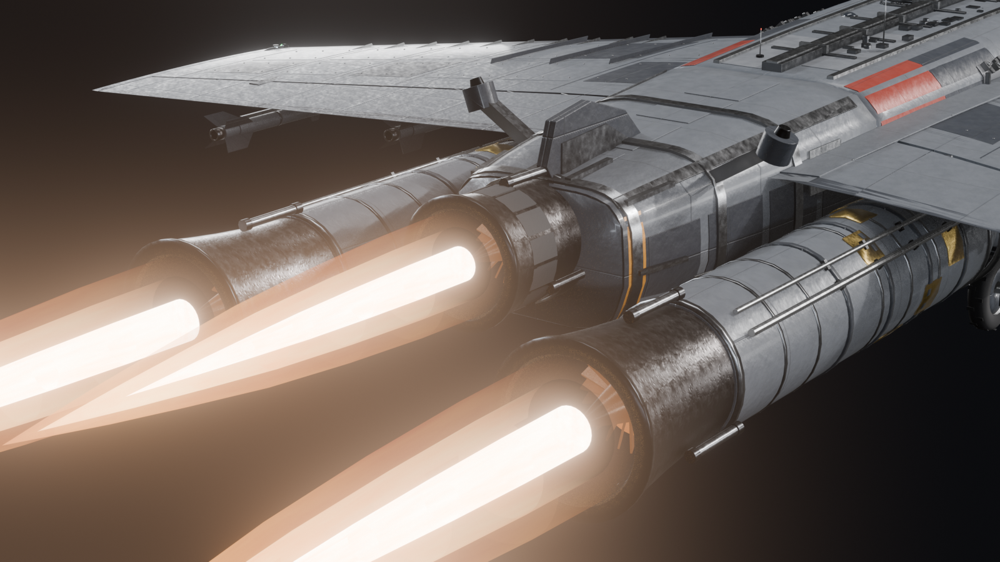
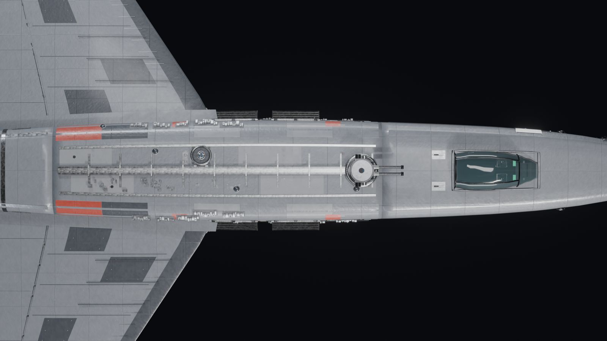
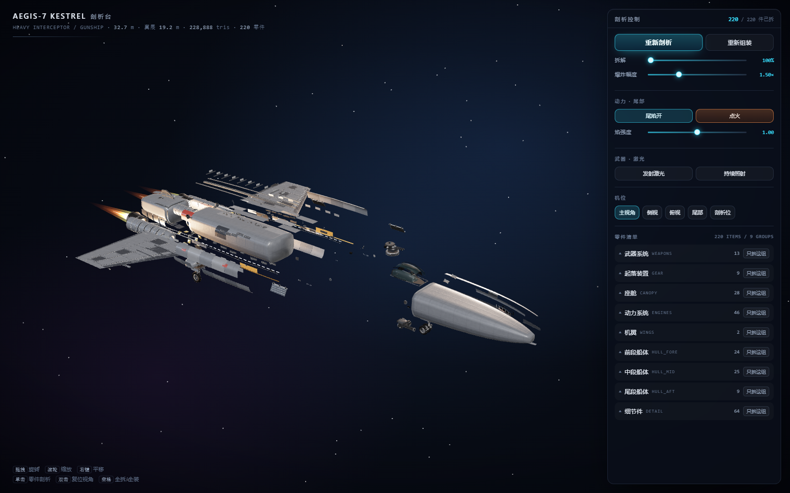
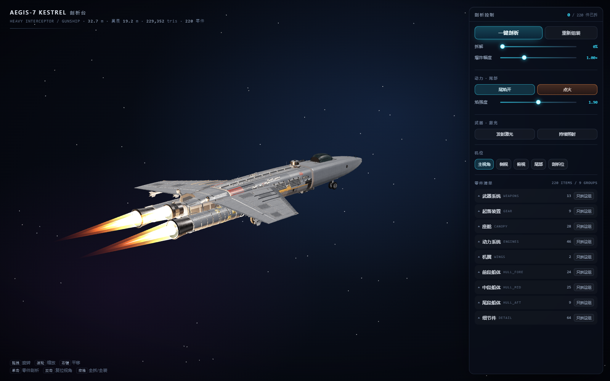

# AEGIS-7 «Kestrel» · 重型截击舰 · 一键剖析

一艘**全程序化生成**的科幻重型截击舰：Blender Python 建模 → glTF → 一个**双击即开、离线可用**
的 three.js 剖析页。点一次「一键剖析」，220 个零件按拆解顺序错峰炸开；尾部三台引擎可以点火喷焰，
背脊炮塔可以发射激光。



| 尾部 · 三台引擎 | 俯视 · 背脊与装甲分块 |
|---|---|
|  |  |

| 剖析态（网页） | 点火（网页） |
|---|---|
|  |  |

---

## 一、直接看

### 网页里转着看（推荐）

`viewer/index.html` 是**单文件离线页**，模型以 base64 内嵌，所以：

- 双击就能开（`file://` 也可以，不需要起服务）
- 也可以起静态服务：`python -m http.server 8000` → `http://127.0.0.1:8000/viewer/index.html`

在线版：<https://hanbuss.github.io/AI-3D-modeling-prompts/projects/03-aegis-7-starship/viewer/index.html>

> 首次打开要下载约 20 MB 的内嵌模型。窄屏（<860px）右侧面板自动收成底部抽屉。

### 在 Blender 里改

几何全部是脚本生成的，改脚本比改网格划算：

```bash
blender -b -P build.py                        # 总装 + 导出 GLB/manifest/ship_meta
blender -b -P tools/render_shots.py           # 9 个机位成品图
blender -b -P tools/audit.py                  # 几何体检（浮空件/退化面/爆炸向量）
```

> `.blend` 刻意没进仓库（8 MB 且可由 `build.py` 一分钟重建）。

### 只想拿模型

`starship.glb` —— 任何支持 glTF 2.0 的引擎都能直接读；`out/manifest.json` 里带着每个零件的
中英文名、分组、拆解序号与爆炸向量，`out/ship_meta.json` 里带着三台引擎的出口坐标与炮塔朝向。

---

## 二、它是什么

| 项 | 值 |
|---|---|
| 全长 / 翼展 / 全高 | 32.59 m / 19.46 m / 4.87 m |
| 可拆零件 | **220 件 / 9 个分组** |
| 三角面 | 229,068 |
| 材质 | 35 个（PBR，12 张程序化贴图） |
| GLB | 14.9 MB |
| 引擎 | 3 台（2 侧吊舱 + 1 中央），2 级涡轮静子叶片环 + 中心锥 + 加力环腔 |

零件分布：细节件 64 / 动力系统 46 / 中段船体 25 / 前段船体 24 / 座舱 28 / 武器系统 13 /
起落装置 9 / 尾段船体 9 / 机翼 2。完整清单见 [`out/parts_table.md`](out/parts_table.md)。

九个分组就是网页里「只拆这组」的九个按钮：武器系统、起落装置、座舱、动力系统、机翼、
前段/中段/尾段船体、细节件。

---

## 三、网页能做什么

- **一键剖析**：按 `order` 错峰飞离（每件 `delay = order×8ms`，`easeOutCubic`，1.1 s），
  「重新组装」原路倒放；拆解滑杆 0–100% + 爆炸幅度 30–260%
- **零件清单**：9 组分组、组头「只拆这组」、件数 >24 时自动折叠并懒建 DOM；
  点单件 → 相机聚焦 + 其余零件半透明 + 信息卡（中英名 / 说明 / 三角面 / 拆解序号）
- **尾焰**：每台引擎 3 层加法混合锥（轴向衰减 × 时间滚动噪声 × 掠射度）+ 白热内芯 + 喷口光斑，
  强度滑杆 0–2、「点火」是 0.8 s 起爆增亮，尾焰跟着引擎零件一起爆炸位移
- **激光**：从炮塔沿轴向射出的双层青光束，蓄能 → 全亮 → 衰减三段相位，另有「持续照射」
- **五机位**：主视角 / 侧视 / 俯视 / 尾部 / 剖析位（尾部机位自动把尾焰纳入取景）
- 深空背景 + 星点、ACESFilmic、窄屏底部抽屉

页内 `viewer/verify.js` 是 19 条自检断言（模型面数、分组数、尾焰层数、激光相位…），
`tools/shot.js` 是 headless Chrome + CDP 的无头验收器（有 console error 时退出码 2）。

### 交互清单（v1.1 新增两项）

- **起落架收放**：短舱（`gear_*_pod`，建模时从支柱里拆出来的固定结构）**一动不动**；
  支柱与机轮沿竖直方向缓缓升入舱腔（升程按"轮顶刚好顶到短舱内腔顶"算），到位后舱门合上；
  放下时反向：门开 → 轮子缓缓放下 → 门合。全程 2 s。API：`STARSHIP.gear(true/false)`
- **腹部转管炮开火**：六管枪束旋转 → 枪口焰 + 曳光弹流（30 发/秒，95 m/s）+ 局部橙色点光，
  「持续扫射」可常开。API：`STARSHIP.fireGun(true, true)`
- **修复**：机翼检修板与蒙皮间 z-fighting 造成的闪烁（相机 near/far 从 0.05/3000 收到 0.55/1400，
  板面抬到 11 mm）；激光照明从 46 m 半径点光改成沿轴向窄锥聚光，不再照亮尾部与中段

---

## 四、工程结构

```
03-aegis-7-starship/
├── build.py                    总装：船体基线 + 各分系统模块 + 统一爆炸向量 + 导出
├── lib/
│   ├── spec.py                 唯一真值：坐标系、站位表、引擎/机翼/武器/起落架、分组
│   ├── hull.py                 船体外形内核：控制点剖面、表面采样、贴合壳面的装甲板
│   ├── kit.py                  硬表面几何内核（box/cyl/loft/prism/boolean/螺栓/碎件/管路）
│   ├── mats.py                 材质库（程序化 PBR 贴图，glTF ORM 口径）
│   ├── shots.py / env.py / export.py   影棚灯光、程序化环境图、GLB 与零件清单导出
│   ├── fore.py                 舰首：弧形舱盖 + 双座座舱 + 鼻锥传感器 + 进气口
│   ├── mid.py                  中段：背脊骨架 + 38 块装甲 + 散热板 + 气闸 + 涂装编号
│   ├── aft.py                  尾段：三台引擎 + 收敛-扩张喷管 + 涡轮静子 + 尾框
│   ├── fx.py                   特效网格：分层尾焰 + 激光束（只进渲染，不进 GLB）
│   ├── wings.py / weapons.py / gear.py   机翼 / 炮塔·转管炮·导弹 / 三点起落架
│   └── aft_lead.py             动力段保底实现（aft/fx 缺席时顶上，保证尾部永不为空）
├── tools/                      冒烟测试 / 成品机位 / 体检 / 零件表 / 打包 / 无头截图
├── out/                        产物：manifest、ship_meta、零件表、体检报告
├── previews/                   9 张 Blender 成品图
├── viewer/                     离线剖析页（含 vendor three.js r160 + 内嵌模型）
└── starship.glb                模型本体
```

---

## 五、设计要点（每条都是踩过坑之后定下来的）

1. **船壳不是超椭圆蛋壳**。`lib/hull.py` 用控制点剖面（平顶甲板 → 肩部倒角 → **硬舷线** →
   下舷 → 平底），在硬边处**复制顶点**，放样后自然形成硬棱。用超椭圆 + 平滑着色，成品永远像香肠。
2. **所有贴付件都通过 `hull.surf(x, th, off)` 取表面点**。表面采样实现为「射线 × 剖面多边形求交」，
   与外形严格一致——这是「装甲板不浮空、不扎进壳里」的唯一保证。`th` 是极角，左舷是 `π − th`。
3. **glTF 只认 `Base Color ← Image Texture` 直连**。中间插 Mix/Multiply 节点会被导出器丢掉，
   网页里整舰变成一坨纯色。所以涂装色是**烘进每张 albedo 贴图**里的，`baseColorFactor` 保持白色。
4. **metallicRoughness 贴图是 R=AO / G=rough / B=metal**。一张灰度图同时喂 G/B 会让金属度掉到
   ~0.3，网页里立刻变灰塑料。
5. **爆炸向量统一算**。`build.refine_explode()` 从全舰包围盒中心按零件中心径向炸开，再按组加权
   （前段向前、尾段向后、机翼/武器向上外、细节件向外），爆炸图才成阵型而不是一锅粥。
6. **尾焰不能是"平涂的自发光锥"**。噪声在 emission 饱和后看不见，必须用顶点属性沿长度衰减
   亮度与不透明度，才有白热芯 → 橙红尾的过渡。
7. **bpy 的两个坑**：`image.pixels.foreach_set` 在某些 5.x 场景会把数据写成 0（贴图必须 numpy 生成
   → 自写 PNG 落盘 → load）；对象 `remove()` 之后旧句柄失效，先抄 name 再删。
8. **Blender 5.x 合成器改版**：`CompositorNodeGlare` 不再是节点属性，改成 socket
   （`inputs['Type'] = 'Bloom'`），按老写法取 `glare_type` 会静默跳过硬光。

---

## 六、已知取舍

- 座舱是**紧凑战斗机**尺度：鼻段半高 1.28 m，装不下真人尺寸座舱，座椅顶距玻璃 0.44 m
- 侧引擎吊舱与机翼下表面间隙约 1 cm（零余量，改翼型前先跑一次实测）
- 尾焰是 shader 锥体 + 顶点衰减，不是体积光；要更电影感可加 EEVEE volumetrics
- `tools/audit.py` 会报 1 个未打标对象（鼻锥安装环）与几处零面积面：不影响渲染与拆解，未清

---

## 七、许可

模型与代码：MIT（见仓库根目录 LICENSE）。模型为原创虚构航天器，与任何真实飞行器无关。
